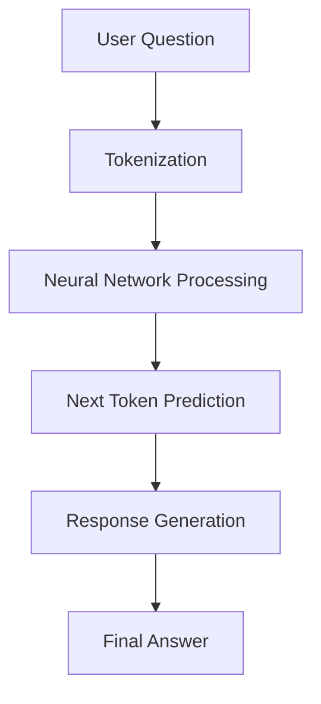

# How Large Language Models (LLMs) Work

## 1. What is an LLM?

A Large Language Model (LLM) is an artificial intelligence model
trained on a large amount of text and other language data.

It learns patterns in language, understands relationships between
words, and generates responses based on the input it receives.

Examples of LLMs include GPT, Gemini, and Llama.

## 2. How does an LLM work?

An LLM processes the user's input, breaks the text into smaller
units called tokens, and converts those tokens into numerical
representations.

It uses its learned patterns and neural network architecture
to predict which tokens should come next.

By repeatedly predicting tokens, it generates a meaningful
response to the user's question.

## 3. Basic Working Process

1. The user enters a question.
2. The input text is converted into tokens.
3. The model processes the tokens using its neural network.
4. The model predicts the next tokens.
5. The predicted tokens are converted into readable text.
6. The generated answer is shown to the user.

## 4. LLM Working Diagram

## 5. What are LLMs used for?

- Answering questions
- Explaining technical concepts
- Summarizing documents
- Generating text and code
- Supporting educational applications
- Helping users understand complex topics

## 6. LLMs in GATENavigator

GATENavigator is designed to help students prepare for GATE.

An LLM can help GATENavigator by:

- Explaining engineering concepts.
- Answering student questions.
- Simplifying difficult topics.
- Providing study guidance.
- Helping students understand GATE syllabus information.

An important limitation is that an LLM can sometimes generate
incorrect information. Therefore, GATENavigator should use
reliable GATE documents and data when answering questions.